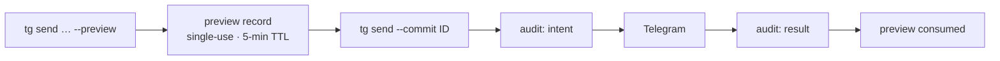

<picture>
  <source media="(prefers-color-scheme: dark)" srcset="docs/assets/readme-banner.svg">
  <source media="(prefers-color-scheme: light)" srcset="docs/assets/readme-banner-light.svg">
  
</picture>

# ✈️ tgcli — Telegram CLI: read, search, send

[](https://github.com/speech115/tgcli/actions/workflows/ci.yml)
[](https://www.python.org/downloads/)
[](LICENSE)

A stateless Telegram client built on [`telethon`](https://github.com/LonamiWebs/Telethon). Signs in as your own user account over MTProto, does exactly one operation per invocation, and gives you JSON-first reading, search, media, export, and preview → commit correspondence from the command line — for humans, scripts, and AI agents alike.

> Third-party tool. Uses the MTProto user API via `telethon`. Not affiliated with Telegram. No daemons, no ports, no LaunchAgents — every command is a foreground process that exits.

Design lineage: [openclaw/gogcli](https://github.com/openclaw/gogcli) (architecture), `tools/telegram` (domain knowledge, sessions, TDLib media experience).

## Contents

[Features](#features) · [Install](#install) · [Quick start](#quick-start) ·
[Documentation](#documentation) · [Configuration](#configuration) ·
[Preview → commit](#preview--commit) · [Operations](#operations) ·
[Status](#status-and-contributing) · [License](#license)

## Features

- **Stateless by design** — one entrypoint, one operation per process. Nothing runs between invocations; state is limited to `~/.config/tgcli/` and `~/.local/state/tgcli/`.
- **Automation contract** — `--json` / `--plain` on stdout, everything human on stderr, documented exit codes, additive-only JSON changes. See [docs/CONTRACT.md](docs/CONTRACT.md).
- **Reading and search** — dialogs with unread/kind filters, id- and date-paginated reads, per-dialog and global search, reply threads, and message context windows. Anything else Telethon can do is one `tg run` script away.
- **Safe correspondence** — `send`, `edit`, and `delete` go through preview → commit with single-use ids, a 5-minute TTL, operation-specific retry checks, and an append-only audit log.
- **Retry-safe sends** — `send` commits carry a stored Telegram `random_id`, so retrying the same preview confirms the original dispatch instead of creating a duplicate.
- **Media and export** — manifest before download, bulk filtered downloads, and JSONL message export with `--resume`.
- **Chat clone** — copy broadcast channels, megagroup supergroups (forum and non-forum), legacy basic groups, and private dialogs into tool-created destinations, with native forwards plus protected-content reupload.
- **Local archive store** — `tg archive` binds a per-account SQLite store, backfills selected/private dialogs, syncs new updates through a GetDifference cursor, acquires bounded voice/video-note media with terminal retry state, transcribes locally with Parakeet, and provides filtered/ranked offline search plus timeline/history views.
- **Scripts** — `tg run SCRIPT` runs Python with the authorized Telethon client for anything without a command; read-only unless `--write`, every write is audited first, and readonly mode refuses scripts entirely.
- **Diagnostics and hygiene** — `tg doctor` reports locally by default (`--connect` for live checks); `tg store cleanup` reclaims local state without ever touching sessions or the audit log.

## Install

`tgcli` requires Python 3.12+ and [`uv`](https://docs.astral.sh/uv/).

Use `tg` (or this checkout's `.venv/bin/python`) for any code that opens a
tgcli session. Do not open `~/.local/state/tgcli/sessions/*.session` with bare
`python3`: a system/user-site Telethon may use an incompatible SQLite session
schema. `tg --json doctor` reports the active runtime under `runtime`.

```bash
git clone https://github.com/speech115/tgcli.git
cd tgcli
uv sync
uv run tg --help
```

On Apple Silicon or Linux, syncing with the `fast` extra also installs `cryptg`, native AES for Telethon that makes large media transfers much faster; `tg doctor` reports the backend in use as `runtime.aes`.

### Put `tg` on your PATH

```bash
./scripts/install-link.sh          # symlinks ~/.local/bin/tg -> .venv/bin/tg
```

Override the target with `TGCLI_BIN_DIR=/somewhere/bin`. The script warns if another `tg` already shadows it on your PATH.

### Configure an account

Create `~/.config/tgcli/config.toml` with credentials from [my.telegram.org](https://my.telegram.org). It holds your API hash, so create it private:

```bash
mkdir -p -m 700 ~/.config/tgcli
install -m 600 /dev/null ~/.config/tgcli/config.toml
```

Then fill it in:

```toml
default_account = "main"

[accounts.main]
api_id = 123456
api_hash = "0123456789abcdef0123456789abcdef"
session = "main"          # session file name under ~/.local/state/tgcli/
```

Then verify:

```bash
tg --json doctor --connect
```

## Quick start

```bash
# 1. What is waiting for me
tg --json dialogs --unread-only

# 2. Read and search
tg --json read @channel --limit 20
tg --json search --all "invoice" --limit 20

# 3. Send — two steps, always
tg --json send @user "hello" --preview     # returns preview_id
tg --json send --commit p_9f3a             # nothing leaves without this

# 4. Media and export
tg --json media download https://t.me/channel/42 --parallel 4
tg --json export messages @channel --output messages.jsonl --resume

# 5. Health and local state
tg --json doctor
tg --json store cleanup --older-than 7d
```

Chat references accept `@username`, a `t.me/` link, or a numeric dialog id; `tg resolve` additionally takes a phone number in E.164 form. Every command takes `--json` (contract data) or `--plain` (TSV); without either, output is human-readable and unstable by design.

## Documentation

| Document | Job |
| --- | --- |
| [SKILL.md](SKILL.md) | every task mapped to its command, plus recipes for paging, catch-up, and retrying a send |
| [docs/CONTRACT.md](docs/CONTRACT.md) | invocation, streams, exit codes, floods and the journal |
| `tg COMMAND --help` | every flag of one command |
| [docs/MCP.md](docs/MCP.md) | the read-only MCP adapter for agents without a shell |
| [Operations](#operations) | running it on a schedule, shipping `main`, what to do when it breaks |
| [AGENTS.md](AGENTS.md) | the rules for changing this repository |

## Configuration

Config lives at `~/.config/tgcli/config.toml`:

| Key | Required | Meaning |
| --- | --- | --- |
| `default_account` | no | Alias used when `--account` and `TGCLI_ACCOUNT` are absent. |
| `accounts.<alias>.api_id` | yes | Telegram API id (integer) from my.telegram.org. |
| `accounts.<alias>.api_hash` | yes | Telegram API hash (string) from my.telegram.org. |
| `accounts.<alias>.session` | no | Session file base name under `~/.local/state/tgcli/sessions/`. Defaults to the alias. |
| `archive.root` | no | Archive store root. Defaults to `~/.local/state/tgcli/archive/`. |

Sessions, locks, previews, the audit log, and cache live under `~/.local/state/tgcli/` (mode `0700`). Account selection order is `--account` > `TGCLI_ACCOUNT` > `default_account`.

**Global flags:** `--account NAME`, `--session-role NAME`, `--json`, `--plain`, `--readonly`, `--timeout SEC` (wall-time deadline — see [CONTRACT §1](docs/CONTRACT.md#1-invocation)), `--max-runtime SEC` (wall-clock cap for long runs: normal stop with a resume pointer), `-v/--verbose`, `--version`.

**Environment overrides:**

| Variable | Effect |
| --- | --- |
| `TGCLI_CONFIG` | Config file path. Defaults to `~/.config/tgcli/config.toml`. |
| `TGCLI_STATE_DIR` | State root for sessions, locks, previews, audit log, cache. |
| `TGCLI_ACCOUNT` | Account alias to use when `--account` is absent. |
| `TGCLI_READONLY` | `1` (or `true`/`yes`/`on`) blocks every mutation before any network work; `0`/`false`/`no`/`off` or unset leaves it off; any other value is a config error (exit 3). |
| `TGCLI_NO_SEND` | Same values; on blocks message-producing mutations specifically. |
| `TGCLI_LIVE_SMOKE` | `1` enables the live-account smoke tests in the suite (read-only; `TGCLI_LIVE_ACCOUNT` picks the alias). |

**Exit codes:**

| Code | Meaning |
| --- | --- |
| 0 | success |
| 1 | runtime error |
| 2 | blocked by safety policy |
| 3 | config or authentication error |
| 4 | not found |
| 5 | rate limited; JSON error carries `retry_after` |

## Preview → commit

Reads are free. Preview-backed mutations — `send`, `edit`, `delete`, and `clone init` — use two invocations. The first resolves and renders the exact intent into a single-use preview record; the second commits that record by id, without retyping it. `clone sync` and `tg run --write` do not mint a preview, but remain gated by `--readonly` / `TGCLI_READONLY` and audited.



```bash
tg --json send @channel "<b>bold</b> and a <tg-spoiler>secret</tg-spoiler>" \
  --format html --preview
# → {"preview_id": "p_9f3a", "to": {…}, "text": "…", "expires_at": "…"}

tg --json send --commit p_9f3a
```

- Previews expire after 5 minutes and are consumed on commit.
- `send`, `edit`, and `delete` commits use the retryable preview lifecycle: after a network/runtime failure, retry the same preview id; never create a second preview. `send` additionally uses its stored Telegram `random_id` for network-level deduplication.
- `clone init` commits use the same retryable
  `begin_commit` / `finish_commit` handshake as `send`/`edit`:
  after a mid-commit failure, retry the same preview id within its TTL;
  never create a second preview for that attempt. Already-applied work is
  recovered or rechecked by the command. A FloodWait during the preview
  scan itself still needs a new preview after the wait.
- `--readonly`, `TGCLI_READONLY=1`, and `TGCLI_NO_SEND=1` hard-block mutations with exit 2, before any network call.
- Every committed mutation is appended to the audit log; `tg store cleanup` can never delete it.

## Operations

How the owner's Mac runs tgcli, how a merged change reaches it, and what to do
when something breaks. The exit codes and journal are defined in
[docs/CONTRACT.md](docs/CONTRACT.md), which wins where the two differ.

### Layout on the Mac

| Path | What it is |
|---|---|
| `~/Projects/tools/tgcli` | development checkout, where agents work |
| `~/Projects/tools/tgcli-prod` | git worktree of the same repository on branch `main`; this is what runs |
| `~/.local/bin/tg` | symlink to `tgcli-prod/.venv/bin/tg` (made by `scripts/install-link.sh`) |
| `~/.config/tgcli/` | config: accounts, `api_id` |
| `~/.local/state/tgcli/` | sessions, previews, audit, journal, clone and archive state |

Scheduled work (archive sync, transcription, clone sync) is launchd calling
the same `tg` on PATH; see the archive row in [SKILL.md](SKILL.md) and
[Keeping clones current](#keeping-clones-current).

### Keeping clones current

One launchd job per clone runs `clone sync` on a short interval. tgcli keeps no
daemon: the job starts, finds out whether the source has anything new, and
exits.

```xml
<key>Label</key>
<string>com.tgcli.clone-sync.SOURCE</string>
<key>ProgramArguments</key>
<array>
  <string>/Users/you/.local/bin/tg</string>
  <string>--account</string><string>A</string>
  <string>--session-role</string><string>job</string>
  <string>--max-runtime</string><string>240</string>
  <string>--json</string>
  <string>clone</string><string>sync</string><string>SOURCE</string>
</array>
<key>StartInterval</key>
<integer>120</integer>
```

The command is `tg --account A [--session-role job] --max-runtime 240 --json
clone sync SOURCE`. Leave out `--session-role job` if no one else uses the
account's primary session. With a role, authorize it once (`tg accounts login A
--role job --phone PHONE`), so a sync never holds the session your own
commands need.

Why it is safe and cheap to run this often:

- An idle run costs the session check plus one one-message history read of the
  source, and of its discussion group when comments are copied. It copies
  nothing, opens no destination and lists no roster, and says
  `"up_to_date":true`. A full run happens when something is new, and once a
  day for the roster (`participants`).
- A FloodWait that ends a sync (exit 5) is written into the clone as
  `retry_not_before`. Every run before that time exits 5 with the remaining
  `retry_after` and sends no request, so a short interval never sends into a
  live ban. `tg clone status` shows the field.
- `--max-runtime 240` ends a long copy as a normal stop (exit 0, `remaining`
  true); the next run resumes at the saved cursor. launchd starts no second
  instance while one runs, and the clone's own lock refuses an overlap with a
  manual run (exit 2).

### Shipping a merged change

`main` is what runs. A merge does nothing on the Mac until `tgcli-prod` moves.

#### Before

- [ ] The PR's `checks` and `test` jobs are green, and so is the `main` run
      after the merge. A red `main` run means two green PRs conflict in
      meaning: fix forward before you move `tgcli-prod`.
- [ ] No one-shot long run is in flight: no `clone sync` or `archive sync`
      started by hand or by launchd is running right now
      (`pgrep -fl 'bin/tg '`). A run picks up the new code only on its next
      start, but swapping files under a running process is not worth it.
- [ ] Note the current commit, so a rollback is one command:
      `git -C ~/Projects/tools/tgcli-prod rev-parse --short HEAD`.

#### Ship

```bash
cd ~/Projects/tools/tgcli-prod
git fetch origin main
git merge --ff-only origin/main
uv sync --frozen --extra fast   # frozen: never rewrite uv.lock; the extra keeps cryptg
```

The merge refuses anything but a fast-forward. If it refuses, someone
committed in `tgcli-prod` by hand: look at `git log origin/main..HEAD` before
doing anything else.

#### Verify

- [ ] `tg --version` matches `pyproject.toml`.
- [ ] `tg --json doctor --connect` reports `"ok": true` for every account, and
      `runtime.python` points into `tgcli-prod/.venv` and `runtime.aes` is
      `cryptg`.
- [ ] One read: `tg --json dialogs --limit 3` exits 0.
- [ ] If the change touched clone or archive: the next scheduled run exits 0
      (the invocation journal shows its `exit_code`, see below).

#### Roll back

Roll back when the verify step fails, or a scheduled run starts exiting 1
right after the ship:

```bash
cd ~/Projects/tools/tgcli-prod
git reset --keep <commit noted before>
uv sync --frozen --extra fast
```

Then open an issue or a fix PR. The next ship fast-forwards past the bad
commit once the fix is on `main`. Local state needs no rollback unless the
change migrated a SQLite schema: then the older code may refuse the newer
database, and the fix goes forward, not back.

### Release (only when the owner asks)

Releases are rare: one user runs `main`. When asked:

- [ ] A PR bumps `version` in `pyproject.toml` and `__version__` in
      `src/tgcli/__init__.py` to the same `X.Y.Z`. A `Breaking:` PR title
      replaces a major bump, so the number is the owner's call.
- [ ] After it merges, tag that merge commit: `git tag vX.Y.Z <sha>` and
      `git push origin vX.Y.Z`.
- [ ] `gh release create vX.Y.Z --generate-notes`, then trim the notes to what
      a user would notice.
- [ ] Ship to the Mac as above.

### When something breaks

Start with the exit code and the JSON error envelope on stdout
(`error.code` and `error.message`), then the journal:

```bash
tail -n 20 ~/.local/state/tgcli/invocations.jsonl
```

Each line has `command`, `exit_code`, `error` (the code only, such as
`CONFIG`), `error_site` (where in tgcli it failed) and, for exit 5, `retry_after`. It never holds
message text. Rerun the failing command with `-v` for Telethon debug logs on
stderr.

| Symptom | What it means | What to do |
|---|---|---|
| exit 3, `error.message` says `needs reauthentication` | the session is dead: revoked, expired, or the key is unregistered | `tg --json accounts login ALIAS --phone PHONE`, then `--continue LOGIN_ID --code …`; check with `tg --json accounts show ALIAS`. A role session (`--session-role job`) needs its own login with `--role job` |
| exit 3 after a wait (up to 120 s, less if `--max-runtime` is shorter), `error_site` `session:session_file_lock` | another tg run holds this session. `accounts login` and `accounts remove` do not wait: they exit 2 at once | wait for it, or find it with `pgrep -fl 'bin/tg '`. Scheduled jobs that overlap with manual work should use `--session-role job` |
| exit 3 from `archive sync` or `transcribe` | the same command is already running for this account (each has its own lock) | nothing; the next scheduled run continues |
| exit 5 with `retry_after` | Telegram FloodWait longer than 30 s, or any FloodWait in `clone init --commit`, `clone sync` or `tg run --write`. Nothing is stored: the wait is only in this error and in the journal row | wait `retry_after` seconds before the next run; an earlier rerun sends the request again and may draw a longer wait. A scheduler should skip its next start until then |
| exit 1 `TIMEOUT` with a `session … is busy; waiting` note on stderr | another tg run held the session for longer than `--timeout` (60 s by default) | wait for it, or pass a larger `--timeout`; the busy wait itself gives up after 120 s with exit 3 |
| `clone sync` or `archive sync` exits 1 mid-run | lost connection or an untranslated server error; the run stops rather than marking items failed | rerun the same command; both resume from their saved cursor |
| a run exits 0 with `stop_reason: "wall_clock_cap"` or `remaining: true` | it hit `--max-runtime` or a budget, not an error | nothing; the next run continues from the resume pointer |
| `archive status` lists `gaps` | Telegram could not deliver part of the update history (`differenceTooLong`), or the stored cursor did not decode | nothing; `archive sync` re-reads every chat that moved and clears the gap once no catch-up is left. Edits and deletions inside the lost stretch stay lost |
| `clone init --commit` stops partway (a flood on the discussion link, say) | the preview is spent only on success | rerun the same `--commit PREVIEW_ID` while it is unexpired (5 minutes); it resumes |
| exit 2, `BLOCKED` | a safety gate refused (`--readonly`, `TGCLI_READONLY=1`, `TGCLI_NO_SEND=1`), or an argument was refused (a bad `--limit`), or a busy session on `accounts login`/`remove` | for the gates: intended in agent sessions. For an owner-approved write, prefix that one command with `TGCLI_READONLY=0`; `TGCLI_NO_SEND=1` must be unset too |
| state directory keeps growing | old previews, login attempts, abandoned clone media caches | `tg --json store cleanup --older-than 7d` to see what would go, and add `--confirm` to delete. Sessions and their `.bak` are never deleted |
| `doctor` shows `runtime.aes: "pyaes"` | slow pure-Python crypto | `uv sync --frozen --extra fast` in `tgcli-prod` installs `cryptg` |

If none of these fits, keep the journal line and the stderr output, and open
an issue. Never open a `.session` file with bare `python3` to look inside: the
pinned Telethon writes a schema that older versions crash on.

### tg-serve protocol

`tg-serve` keeps one session connected for programs that run many `tg`
commands in a row, so each command skips the import and connect a `tg`
process pays.

#### Run it

```bash
tg-serve [--account main] [--session-role NAME]
```

Give it its own session role (`tg accounts login main --role NAME --phone …`):
the held session file stays locked while the server runs.

#### Protocol

One JSON object per line. After connecting, the server writes:

```json
{"ready": true, "account": "main", "role": "mcp"}
```

Each request names a `tg` command without global flags; the server adds
`--account`, `--session-role` and `--json`. Put positional values after `--`
so text that starts with `-` is never read as a flag:

```json
{"argv": ["read", "--limit", "5", "--", "@channel"], "stdin": ""}
```

The reply carries what that `tg` invocation would have printed and its exit
code ([CONTRACT](docs/CONTRACT.md) §4):

```json
{"exit_code": 0, "stdout": "{\"dialog\": …}\n", "stderr": ""}
```

- `stdin` (optional) is what the command reads from stdin, for `run -`,
  `--code -` or `--password-stdin`.
- A request that sets `--account` or `--session-role`, or is not a JSON object
  with a non-empty `argv` list, gets exit code 1 and a `USAGE` error.
- If the session cannot be opened, the server writes the error envelope to
  stdout instead of the ready line and exits with its code (3 for an
  unauthorized or busy session).
- Requests run one at a time, in order. Closing stdin ends the server and
  releases the session.

## Status and contributing

In production use by its owner. New behavior starts from an owner request, and a bug fix starts from a reproducing test. Run `./scripts/gate.sh` before a pull request; CI runs the same steps ([.github/workflows/ci.yml](.github/workflows/ci.yml)). [AGENTS.md](AGENTS.md) holds the working rules. Report a security or privacy issue privately via [SECURITY.md](SECURITY.md); never paste session material or phone numbers into an issue.

## Credits

- Architecture and CLI posture modelled on [`gogcli`](https://github.com/openclaw/gogcli).
- Local-state hygiene and offline diagnostics adopted from a review of [`wacli`](https://wacli.sh).
- Built on [`telethon`](https://github.com/LonamiWebs/Telethon) by LonamiWebs.

## Maintainers

- [@speech115](https://github.com/speech115)

## License

[MIT](LICENSE) © speech115. `telethon` ships under its own MIT license; this tool is not affiliated with Telegram.
