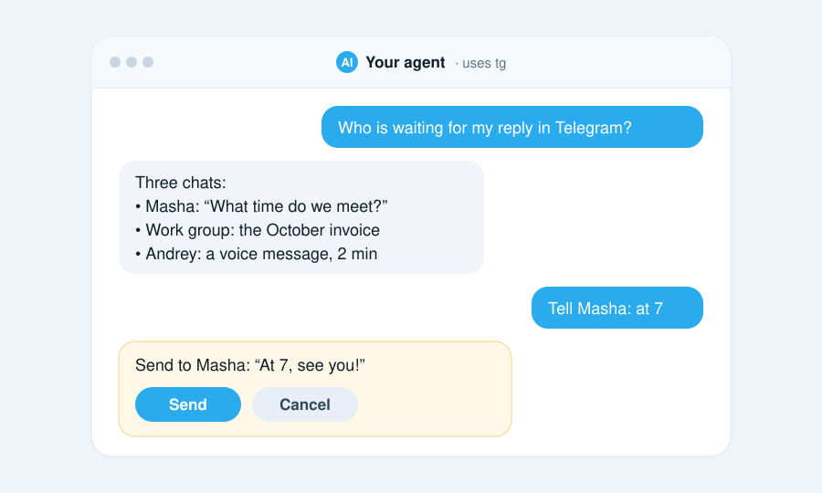

<picture>
  <source media="(prefers-color-scheme: dark)" srcset="docs/assets/readme-chat-dark.svg">
  <source media="(prefers-color-scheme: light)" srcset="docs/assets/readme-chat-light.svg">
  
</picture>

<div align="center">

# tgcli

**Your AI agent reads and answers your Telegram. Nothing is sent until you say yes.**

Works with Claude Code, Codex, Antigravity and Gemini CLI on macOS and Linux.

[](https://github.com/speech115/tgcli/releases/latest)
[](LICENSE)

</div>

## Install

Paste this into your AI agent. It does the rest; you only log in to Telegram on a page it opens.

```text
Установи tgcli для Telegram по инструкции
https://github.com/speech115/tgcli/blob/main/INSTALL_FOR_AGENTS.md
и подключи мой аккаунт
```

<sub>In English: “Install tgcli for Telegram by following https://github.com/speech115/tgcli/blob/main/INSTALL_FOR_AGENTS.md and connect my account”. Paste the same line again to update or repair it.</sub>

## What you can ask

- Что у меня непрочитанного в Telegram?
- Кто ждёт моего ответа?
- Найди сообщения про счёт за октябрь
- Перескажи, что писали в канале за неделю
- Скачай видео из этого поста
- Напиши Маше, что я опоздаю на 10 минут

## Safe by design

- Before anything is sent, edited or deleted, the agent shows you the exact text and chat and waits for your yes.
- Your Telegram login stays on your computer. tgcli talks only to Telegram.
- What the agent reads goes to your AI provider, like anything else you show it.

## FAQ

<details>
<summary><b>Is this a virus? What is the <code>tg</code> process, or the "arm64" device?</b></summary>

No. `tg` is this open-source program, installed by your agent at your request. It runs only while your agent uses it. Each command does one thing and exits. `tg setup` stays open while its login page is open.

In Telegram, under **Settings**, then **Devices**, the tgcli login shows as **tgcli**. The old speech115/tg did not name itself, so Telegram listed it by the Mac's processor type, **arm64**. To end a login you don't recognize, end it there. `tg` then asks to be connected again.

</details>

<details>
<summary><b>Telegram logged me out of Telegram Desktop</b></summary>

tgcli does not log out your other devices. It has no command that ends sessions. Telegram may end sessions on its own after a login it finds unusual. Log in to Telegram Desktop again with its QR code. On the phone, open **Settings**, then **Devices**, then **Link Desktop Device**. `tg` keeps working. To check, ask your agent to run `tg doctor`.

</details>

<details>
<summary><b>The agent refuses, or says it has no access to Telegram</b></summary>

- Start a new chat. Agents read their instructions and skills when a chat starts.
- Add «через tg» ("use tg") to the request.
- Codex: restart it after the install, so that it loads the rule that lets `tg` reach Telegram. If it asks, approve running `tg` outside the sandbox.
- Antigravity: its sandbox has no internet. When it asks, approve running `tg` outside the sandbox.
- Still stuck: paste the install line again. The guide checks every step and repairs what is missing.

</details>

<details>
<summary><b>I had the old speech115/tg</b></summary>

That project is archived, and tgcli replaces it. Paste the install line. The agent removes the old `tg` and installs tgcli. The old login stays in `~/.config/tg/` and `~/.local/state/tg/`, but tgcli does not use it, so you connect once more on the browser page. You can reuse the same `api_id` and `api_hash`. When tgcli works, end the old **arm64** session in Telegram under **Settings**, then **Devices**.

</details>

## For developers

The `tg` command, its JSON contract, manual install and operations: [docs/DEVELOPERS.md](docs/DEVELOPERS.md). Agents start with [SKILL.md](SKILL.md).

Third-party tool, not affiliated with Telegram. [MIT](LICENSE) © speech115.
